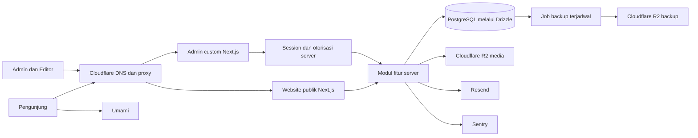

# Arsitektur Sineva Compro — admin custom

**Tanggal:** 14–15 Oktober 2026. **Status:** arah produk disetujui Founder; fondasi pengganti teruji, review independen selesai dan verifikasi browser production lokal lulus. Source/metadata PR telah dipublikasikan; PR #1 siap review, belum merge/deploy.

**Acuan:** [PRD Rev. 2](../prd/2026-10-14-company-profile-prd.md), [keputusan arsitektur](decisions/2026-10-14-custom-admin.md), dan [rencana CPR-7](../superpowers/plans/2026-10-14-cpr-7-foundation.md).

Fondasi awal pada commit `a7f00fb` menggunakan Payload. [Hasil verifikasi lama](foundation-validation.md) hanya berlaku untuk fondasi tersebut. Source, dependency, schema dan test pengganti telah dipublikasikan pada branch CPR-7 melalui commit `e9cb9b3`; PR #1 kini memuat implementasi custom. Bukti baru dicatat di [verifikasi custom](custom-admin-foundation-validation.md); bukti historis tetap terpisah.

## 1. Arsitektur sistem

Compro memakai **modular monolith**: website publik dan admin custom berada dalam satu aplikasi Next.js, satu repo, dan satu deployment. Aplikasi memiliki model data, form, query dan aturan publikasi sendiri di PostgreSQL. Tidak menggunakan headless CMS. Chatbot tetap mempunyai repo, database dan deployment terpisah; Compro hanya menerima waitlist dan menampilkan informasi produk.



Website, admin, session, dan fitur adalah modul dalam proses yang sama, bukan service/container terpisah. Better Auth menyediakan mekanisme autentikasi; aplikasi menentukan izin domain dan UI admin. Drizzle adalah library akses data/migration, bukan CMS. [Integrasi Next.js](https://better-auth.com/docs/integrations/next), [adapter Drizzle](https://better-auth.com/docs/adapters/drizzle).

Satu VPS sesuai keputusan awal; kegagalan host dapat menghentikan aplikasi dan database sekaligus. Backup di luar VPS, restore teruji, dan monitoring eksternal tetap diperlukan. Replica, Redis, message broker, dan cluster baru dipertimbangkan berdasarkan kebutuhan terukur.

| Lingkungan | Isolasi |
|---|---|
| Lokal | Database developer persisten; test memakai service/database terpisah |
| Preview | Database per PR pada instance staging, credential/prefix media per PR, tanpa data pribadi production |
| Production | Database, credential, media, dan provider khusus production |

CPR-11 menentukan provisioning dan cleanup yang hanya menyentuh resource PR tersebut. Migration SQL dilacak di Git, direview, dan dijalankan oleh satu langkah deploy sebelum trafik aplikasi baru. Startup tidak membuat database atau mengubah schema otomatis; rolling deploy memakai perubahan yang tetap kompatibel dengan versi lama. [Migration Drizzle](https://orm.drizzle.team/docs/migrations).

## 2. Batas modul dan dependensi

```text
Route / komponen UI
        ↓
Query server / Server Action fitur
        ↓
Validasi + session/izin + aturan bisnis
        ↓
Query Drizzle / adapter provider
        ↓
PostgreSQL / R2 / Resend / Turnstile
```

Read sederhana cukup berupa query server eksplisit. Service digunakan untuk workflow nyata, misalnya validasi → anti-spam → simpan lead → email; tidak membuat wrapper CRUD atau lapisan service kosong.

| Bagian | Tanggung jawab | Batas |
|---|---|---|
| `app/` | Routing, layout, metadata, komposisi, handler auth | Tidak menampung seluruh query/workflow |
| `features/<fitur>/` | Schema domain, query, validasi, action, service, UI fitur | Tidak mengimpor halaman atau internal fitur lain |
| `features/auth/` | Session, izin domain, lockout, pengelolaan akun | Role berasal dari server |
| `lib/db/` | Pool PostgreSQL, ORM, agregasi schema | Tidak menyediakan generic public CRUD |
| `lib/auth/` | Konfigurasi/integrasi library auth | Tidak menggantikan otorisasi domain |
| `lib/integrations/` | Adapter provider server | Tidak menentukan respons UI/aturan lead |
| `components/` | UI bersama dengan props terbatas | Tidak membaca database, provider server, atau secret |
| `env/` | Konfigurasi tervalidasi | Tidak diekspor lewat barrel client/server campuran |

Schema domain berada bersama fitur dan diagregasi di `lib/db/schema.ts`; schema auth library berada di `features/auth/schema.ts` dan direview bersama migration. Query database tidak mengimpor rendering UI atau adapter email.

Modul Next.js khusus server memakai `server-only`. Helper environment/schema yang juga dibaca CLI tetap dapat dimuat Node biasa. Client Component menerima DTO kecil: hash password, token session, konfigurasi provider, dan data lead tidak ikut props publik. [Keamanan data Next.js](https://nextjs.org/docs/app/guides/data-security).

## 3. Struktur target

```text
src/
├── app/
│   ├── layout.tsx                 Root layout bersama yang minimal
│   ├── (public)/[locale]/         Halaman publik; i18n di subtree publik
│   ├── (admin)/admin/
│   │   ├── login/page.tsx         Login custom
│   │   └── (protected)/           Dashboard dan admin berizin
│   └── api/auth/[...all]/         Handler auth, bukan API konten
├── features/
│   ├── auth/                     Session, izin, lockout, schema auth
│   ├── services/                 Data/form layanan dan query publik
│   ├── portfolio/                Data/form showcase dan publikasi
│   ├── blog/                     Artikel, kategori, rich text, publikasi
│   ├── team/                     Tim dan penulis
│   ├── media/                    Metadata/alt text dan upload
│   ├── site-settings/            Pengaturan dan konten halaman
│   ├── leads/                    Intake publik dan mini-CRM
│   └── waitlist/                 Intake, deduplikasi dan ekspor
├── components/ui/                Design system
├── components/layout/            Header/footer dan shell admin
├── lib/
│   ├── db/                       Pool, ORM dan agregasi schema
│   ├── auth/                     Konfigurasi server/client terpisah
│   ├── cache/                    Pemetaan entity → path/tag publik
│   └── integrations/             Email, storage, anti-spam
├── env/                          Konfigurasi tervalidasi
└── i18n/                         Routing dan messages publik
drizzle/                          Migration SQL dan metadata versioned
scripts/                          Setup dan bootstrap operator
tests/unit/                       Aturan murni
tests/integration/                Database, izin, efek eksternal
tests/e2e/                        Pengunjung dan admin
```

Ini struktur tujuan, bukan instruksi membuat folder kosong. CPR-7 membuat database/auth dan shell admin; schema/form konten mengikuti tiket pemilik. Root layout tetap Server Component. i18n publik tidak mengalihkan `/admin` atau auth handler. Admin v1 berbahasa Indonesia dan bertema terang yang aksesibel; konten ID/EN serta tema terang/gelap publik tetap wajib.

File fitur mengikuti kebutuhan: `schema.ts`, `validation.ts`, `queries.server.ts`, `service.server.ts`, `actions.ts`, `types.ts`, dan UI lokal. Tidak membuat `BaseService`, `BaseRepository`, DI container, atau `utils.ts` raksasa. Tipe ORM tidak otomatis menjadi respons UI.

## 4. Autentikasi dan izin

- Library menangani hashing password, session, cookie, dan logout; aplikasi tidak menulis algoritmanya sendiri. [Better Auth email/password](https://better-auth.com/docs/authentication/email-password).
- Signup publik ditutup. Bootstrap Admin pertama berupa perintah operator terhadap database yang telah dimigrasi, tanpa password bawaan atau endpoint anonim. Perintah menolak salah lingkungan, aman dijalankan ulang dan bersamaan.
- Admin mengelola Editor lewat aksi server berizin. Role, identitas pemilik, status lead, dan catatan internal tidak diambil dari mass assignment input publik. [Pengelolaan akun library](https://better-auth.com/docs/plugins/admin).
- Setiap query, action, upload, preview, dan export memeriksa session aktif serta role di server. Redirect layout/proxy dan menu tersembunyi hanya membantu UI. [Autentikasi Next.js](https://nextjs.org/docs/app/guides/authentication).
- Editor hanya konten/media; tidak membaca Leads/Waitlist, mengekspor data pribadi, mengubah role atau mengelola Users.
- Lockout 15 menit setelah 5 kegagalan berturut-turut, counter database atomik, reset saat login berhasil, respons tanpa pengungkapan email terdaftar. Rate limit request melengkapi lockout. Semua jalur login, termasuk handler auth langsung, melewati kebijakan yang sama.
- Trusted origin sesuai environment; cookie HttpOnly dan Secure di production; logout mencabut session, perubahan role segera berlaku. Session dan query admin tidak masuk cache publik.

## 5. Konten, bahasa dan publikasi

ID entitas stabil; terjemahan disimpan per `(entity_id, locale)`. Constraint bahasa dan slug unik per jenis konten/bahasa berada di database. Relasi memakai foreign key; field berulang boleh berupa JSON terstruktur tervalidasi, bukan satu blob seluruh situs.

Posts dan Portfolio memisahkan draft dari snapshot terbit per bahasa. Query publik memilih snapshot terbit, kolom yang diperlukan, dan locale eksplisit tanpa fallback. Menyimpan draft tidak mengubah snapshot publik. Artikel boleh terbit satu bahasa.

Publish: validasi field/slug → transaksi snapshot/status → invalidasi cache setelah commit. Rename, unpublish, delete memperbarui URL lama/baru, padanan, daftar, beranda dan sitemap. Preview memerlukan session/role, `noindex`, serta respons tanpa cache publik. Tidak membuat API konten CRUD REST/GraphQL generik.

Rich text berupa dokumen JSON tervalidasi dengan renderer aplikasi untuk heading, daftar, tautan, gambar, kutipan dan kode. Batasi URL/elemen; HTML mentah tidak dirender tanpa sanitasi. SEO adalah field schema/form admin yang dibaca `generateMetadata`, tanpa plugin CMS.

## 6. Lead dan integrasi

Form publik → validasi/persetujuan → honeypot/Turnstile/rate limit → pemetaan field yang diizinkan → penyimpanan → percobaan email → hasil aman. Status Baru/waktu/catatan ditetapkan server. Tidak ada endpoint publik untuk membaca, mengubah, menghapus, atau mengekspor Leads/Waitlist.

Lead disimpan sebelum email; email gagal tidak membatalkan lead dan tetap menghasilkan sukses. Log/Sentry meredaksi data pribadi. Network call memiliki timeout/penyelesaian terkelola, tidak menahan transaksi database. Retry/outbox mengikuti kebutuhan dan tiket tersendiri.

Email waitlist dinormalisasi dengan constraint unik; hanya konflik duplikasi yang dikenal menjadi sukses. `find` lalu `create` tidak cukup untuk concurrency. Error database lain tetap kegagalan penyimpanan.

Adapter R2 milik aplikasi memeriksa session/role, tipe/ukuran file, alt text per bahasa, prefix environment; credential tidak masuk browser. Ekspor CSV memerlukan Admin, tidak dicache, dan menghindari formula injection.

## 7. Pattern dan pembuktian

| Pattern | Pemakaian |
|---|---|
| Feature modules | Schema, query, action, UI, dan test mengikuti fitur bisnis |
| Service layer | Workflow berurutan |
| Adapter | Provider mempunyai test double |
| Composition | Halaman menyusun komponen dengan props terbatas |
| Explicit data access | Locale, snapshot, kolom, dan izin jelas pada query |

Dependency injection cukup parameter fungsi/adapter kecil. Pengujian Payload lama tidak dihitung sebagai evidence arsitektur baru.

- Unit: environment, input, normalisasi, izin, pemetaan locale/cache.
- Integrasi: migration bersih, koneksi terbatas waktu, signup ditolak, bootstrap konkuren, session/logout, lockout konkuren, Admin vs Editor, draft tidak bocor, duplikasi waitlist, email gagal setelah lead tersimpan.
- E2E: konsultasi, waitlist, bahasa/tema, login/logout, edit/publish/preview, mini-CRM, ekspor dan penolakan Editor.
- Operasional: build production, health/readiness, backup/restore, resource preview, migration terkontrol.

Dokumen ini adalah target implementasi; versi dependency final, UI, keamanan akses yang sebenarnya dan kapasitas VPS harus dibuktikan setelah fondasi diganti.
