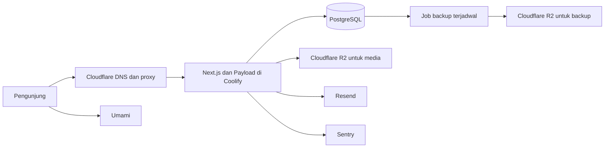

# Arsitektur Sineva Compro

**Tanggal:** 14 Oktober 2026.

**Status:** rancangan untuk direview; implementasi aplikasi belum dimulai.

**Acuan:** [PRD](../prd/2026-10-14-company-profile-prd.md) dan [rencana CPR-7](../superpowers/plans/2026-10-14-cpr-7-foundation.md).

## 1. Arsitektur sistem

Pola aplikasi adalah **modular monolith**: website dan CMS berjalan dalam satu
aplikasi Next.js, dengan batas modul dan hak akses yang eksplisit. Produk chatbot
tetap memiliki repo, lifecycle deployment, dan data yang terpisah. Compro hanya
menampilkan informasi produk dan menerima waitlist.



Satu VPS merupakan pilihan awal sesuai PRD, dengan kompromi bahwa kegagalan host
dapat menghentikan aplikasi serta database sekaligus. Backup di luar VPS, uji
restore, dan monitoring dari luar VPS tetap diperlukan. Menambah replica, Redis,
message broker, atau cluster belum dibutuhkan untuk scope awal; perubahan itu
dipertimbangkan berdasarkan beban dan kebutuhan keandalan yang terukur.

| Lingkungan | Isolasi yang dituju |
|---|---|
| Lokal | PostgreSQL developer dengan volume bernama; test memakai service/database terpisah |
| Preview | Setiap PR memiliki database terisolasi, kredensial terbatas, dan prefix media sendiri |
| Production | Database, kredensial, media, dan konfigurasi provider khusus production |

Untuk preview, satu instance PostgreSQL staging boleh menampung beberapa database
PR; istilah “database staging” pada PRD tidak berarti seluruh preview menulis ke
schema yang sama. Cleanup setelah PR ditutup hanya boleh menghapus resource PR
tersebut. CPR-11 menentukan mekanisme dan batas resource yang benar-benar dapat
diterapkan di Coolify. Preview tidak menerima salinan data pribadi production.
Pilihan awal adalah database per PR pada instance staging yang sama; tidak
bergantung pada opsi `schemaName` eksperimental adapter Payload.

Migration dijalankan oleh satu langkah deployment yang terkontrol sebelum
aplikasi baru menerima trafik. Jangan menjalankan migration yang sama dari setiap
replica atau mengaktifkan development schema push di production. Pada saat ada
rolling deployment, perubahan schema perlu tetap kompatibel dengan versi
aplikasi lama selama keduanya hidup bersamaan.

## 2. Batas aplikasi dan arah dependensi

Alur dependensi aplikasi:

```text
Halaman / komponen UI
        ↓
Server Action atau query server milik fitur
        ↓
Aturan bisnis fitur
        ↓
Payload Local API atau adapter provider
        ↓
Database / layanan eksternal
```

Untuk read konten yang sederhana, query server fitur langsung memakai Payload;
tidak perlu memaksakan lapisan service kosong. Service digunakan ketika terdapat
alur bisnis yang nyata, seperti validasi, anti-spam, penyimpanan lead, dan
pengiriman notifikasi.

| Bagian | Tanggung jawab | Batas |
|---|---|---|
| `app/` | Routing, layout, metadata, komposisi halaman | Tidak menjadi tempat seluruh query dan workflow bisnis |
| `features/` | Query publik, validasi input, workflow, hasil yang dikonsumsi UI | Fitur tidak mengimpor halaman atau komponen internal fitur lain |
| `collections/`, `globals/` | Schema CMS, access control, field validation, hook perubahan konten | Tidak berisi rendering UI atau workflow form publik yang panjang |
| `lib/cms/` | Inisialisasi Payload yang hanya dipakai pada server | Tidak membungkus seluruh Local API sebagai generic repository |
| `lib/integrations/` | Adapter email, anti-spam, dan provider lain | Tidak menetapkan aturan bisnis lead atau menentukan respons UI |
| `components/` | Komponen UI dan layout yang dipakai lintas halaman | Tidak membaca secret atau menjalankan SDK database/provider |
| `env/` | Pembacaan serta validasi konfigurasi server | Tidak diekspor lewat barrel yang juga dipakai client |

Kode server khusus Next dapat memakai guard `server-only`. Helper environment
yang juga dipakai CLI Payload dan unit test tetap dapat dimuat oleh Node biasa.
Jangan memberikan seluruh objek dokumen CMS, kredensial, atau detail error
provider sebagai props Client Component; petakan field yang benar-benar dibutuhkan
menjadi hasil serializable yang kecil. [Panduan keamanan data Next.js](https://nextjs.org/docs/app/guides/data-security).

## 3. Struktur kode yang bertumbuh sesuai tiket

```text
src/
├── app/
│   ├── (frontend)/
│   │   └── [locale]/          Routing bahasa pada CPR-25
│   └── (payload)/            Entry admin/API resmi Payload
├── features/
│   ├── services/             Query dan tampilan layanan
│   ├── portfolio/            Query studi kasus
│   ├── blog/                 Query artikel terbit dan kategori
│   ├── leads/                Validasi dan workflow konsultasi
│   └── waitlist/             Validasi, normalisasi, dan deduplikasi
├── components/
│   ├── ui/                   Komponen design system
│   └── layout/               Header, footer, navigasi
├── collections/              Schema Users, Posts, Leads, dan lainnya
├── globals/                  Pengaturan Situs dan konten global
├── lib/
│   ├── cms/                  Inisialisasi SDK server
│   └── integrations/         Email, anti-spam, dan logging provider
├── env/                      Konfigurasi tervalidasi
├── i18n/                     Routing dan konfigurasi bahasa
├── migrations/               Migration hasil CLI, direview dan dilacak
├── payload.config.ts
└── payload-types.ts           Hasil generator

tests/
├── unit/                     Aturan validasi dan transformasi tanpa network
├── integration/              Izin, persistence, deduplikasi, error provider
└── e2e/                      Alur pengunjung dan admin
```

Ini struktur tujuan saat fitur mulai dikerjakan, bukan instruksi membuat semua
folder kosong pada CPR-7. Foundation hanya membuat route group, environment,
Users, konfigurasi, migration awal, dan tests yang memang dibutuhkan.

Setiap fitur boleh memiliki `queries.server.ts`, `validation.ts`,
`service.server.ts`, `actions.ts`, serta komponen sendiri jika ada kebutuhan nyata.
File tipe respons dipasang bersama fitur pemiliknya. Schema model berasal dari
types yang dihasilkan Payload; tipe data untuk UI hanya memuat field yang
dibutuhkan. Hindari `utils.ts` raksasa, barrel yang mencampur server/client, dan
kelas `BaseService` atau `BaseRepository` yang hanya memindahkan panggilan SDK.

## 4. Pattern untuk konten dan data pribadi

**Konten publik:** query server mengirim locale secara eksplisit, mengambil hanya
field yang digunakan halaman, dan menerapkan access control serta status terbit.
Artikel tanpa terjemahan tidak tampil melalui fallback bahasa pada daftar bahasa
lain. Preview draft memerlukan pengguna CMS yang berhak dan tidak ikut cache
publik. Revalidation setelah publish memperbarui halaman padanan kedua bahasa.

**Akses Local API:** untuk Payload v3, jangan mengandalkan default opsi SDK.
`overrideAccess: false` ditulis eksplisit pada operasi yang perlu memeriksa izin;
operasi pengguna CMS menyertakan user yang diperoleh melalui autentikasi server.
Operasi baca publik tidak menggunakan identitas admin. Ini mengikuti
[opsi Local API Payload](https://payloadcms.com/docs/local-api/overview).

Hook koleksi memakai instance `req.payload` yang sudah ada dan meneruskan `req`
jika melibatkan transaksi. Jangan mengimpor factory CMS global dari hook yang
dibaca saat `payload.config.ts` dibangun: pola itu dapat menciptakan import
melingkar atau menginisialisasi ulang Payload. Hook revalidation harus kecil dan
memanggil fungsi invalidasi yang terpisah dari query/init CMS.

**Write lead dari pengunjung:** REST create koleksi Leads tetap ditutup untuk
publik sesuai PRD. Server Action memperlakukan semua input sebagai tidak tepercaya.
Setelah validasi dan anti-spam, satu workflow server internal di fitur Leads
boleh melakukan write dengan `overrideAccess: true` secara sengaja. Pengecualian
ini hanya untuk create field lead yang sudah dinormalisasi, bukan read/modify Users,
ekspor data, atau query generik berdasarkan nama koleksi dari client. Jangan membuat
akun admin palsu untuk mewakili pengunjung. Pengecualian tersebut harus memiliki
negative tests sebelum digunakan pada M3.

Field internal seperti status awal, catatan internal, dan identitas pemilik
ditentukan server. Input form dipetakan ke daftar field yang diizinkan; jangan
menyebarkan seluruh objek input client langsung ke operasi create.

**Form dan email:** server memvalidasi input/persetujuan → memeriksa anti-spam →
menyimpan lead → mencoba notifikasi/balasan → mengembalikan hasil form yang aman.
Kegagalan email tidak membatalkan lead yang sudah tersimpan. Panggilan email
memiliki timeout dan ditunggu/dikelola secara eksplisit, tidak berupa promise yang
dilepas begitu saja. Jangan menahan transaksi database selama request email.
Kegagalan dicatat dengan redaksi data pribadi, tanpa isi form lengkap atau secret.
Mekanisme retry/outbox ditambahkan hanya bila menjadi kebutuhan yang disepakati,
melalui tiket tersendiri; tidak dibuat pada fondasi CPR-7.

**Waitlist:** email dinormalisasi dan mempunyai constraint unik di database.
Pemeriksaan `find` lalu `create` saja tidak cukup untuk kiriman bersamaan.
Hanya konflik duplikasi yang diketahui diterjemahkan menjadi hasil sukses yang
sama; error database lain tetap ditangani sebagai kegagalan penyimpanan.

**Caching:** hanya konten terbit yang boleh masuk cache publik. Key mencakup locale
dan konteks environment. Data Leads, Waitlist, Users, serta hasil autentikasi tidak
masuk cache publik. Server Action yang mengelola data CMS harus memeriksa
autentikasi/otorisasi setiap request; keberadaan tombol di UI tidak menjadi batas
keamanan.

## 5. Pattern pengujian dan batas kesimpulan

Pattern kode yang dipakai sesuai kebutuhan:

| Pattern | Pemakaian |
|---|---|
| Feature modules | Kode layanan, blog, lead, dan waitlist dikelompokkan menurut perubahan bisnis |
| Service layer | Workflow form mempunyai satu pemilik urutan validasi, write, dan notifikasi |
| Adapter | Provider email/anti-spam dapat diganti atau diberi test double tanpa mengubah workflow |
| Composition | Halaman menyusun komponen kecil, dengan data yang diperlukan melalui props |
| Explicit data access | Query menentukan izin, locale, field, dan status publik; tidak bergantung pada default SDK |

Dependency injection cukup melalui parameter fungsi atau adapter kecil saat ada
efek eksternal yang perlu diuji. Tidak membuat DI container, generic CRUD service,
atau hierarchy kelas sebagai prasyarat membangun fitur.

- Unit: input kosong/salah, normalisasi, dan aturan bisnis tanpa SDK network.
- Integrasi: izin Local API/REST, schema migration, write ke database test,
  duplikasi bersamaan, serta email gagal setelah data tersimpan.
- E2E: konsultasi, waitlist, bahasa, tema, dan alur admin melalui browser.
- Operasional: production build, health/readiness, backup/restore, resource preview,
  serta startup pada schema yang sudah dimigrasi.

Pada tahap ini arsitektur dinilai layak untuk scope Compro, tetapi kualitas kode,
kompatibilitas dependency akhir, akses data yang sebenarnya, dan kapasitas VPS
harus dibuktikan melalui implementasi dan pengujian. Dokumen ini tidak mengklaim
aplikasi sudah siap production.
